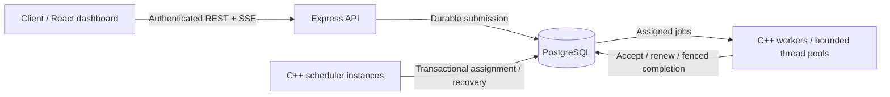

# TaskForge

**A distributed job queue and workflow engine built with C++20, PostgreSQL, and TypeScript.**

Submit background work through an Express API, execute it across bounded C++ worker pools, and inspect real results through a React dashboard. TaskForge implements its own scheduler, lease protocol, retry handling, and dependency coordination.

## Architecture



PostgreSQL is the source of truth. The C++ scheduler grants leases using worker and queue row locks plus `FOR UPDATE SKIP LOCKED`. Workers renew leases and submit outcomes with an increasing attempt number. Stale or expired completions cannot overwrite the current attempt. Services communicate through constrained database procedures; workers do not expose HTTP execution endpoints.

**Execution is at least once.** A crash after an external side effect but before durable completion can cause that effect to repeat. Submission idempotency avoids duplicate job records; application handlers still need an idempotency strategy for their external effects.

## Run locally

Requires Git, Node.js 22.12+ (for the setup script or local development), and Docker Desktop with Linux containers running. A host C++ compiler and PostgreSQL installation are not needed for Compose.

```powershell
git clone https://github.com/techvoyager-varun/TaskForge.git
cd TaskForge
node scripts/setup-env.mjs
docker compose up -d --build --scale worker=2 --scale scheduler=2
docker compose run --rm admin "My project"
```

The last command prints a project ID, default queue ID, and a newly generated access token. Keep the token private. Open **http://127.0.0.1:3000**, enter that token, and submit a job. If port 3000 is occupied, set `HTTP_PORT=3001` in `.env` before starting Compose.

Only the API/dashboard port binds to the host, on loopback. PostgreSQL has a persistent named volume and no published host port. The migration container applies versioned schema changes and provisions separate least-privilege logins for the API, scheduler and workers. The dashboard token stays in browser session storage and is removed on disconnect.

```powershell
docker compose ps
docker compose logs -f scheduler worker
docker compose up -d --scale worker=4 --scale scheduler=2
docker compose stop
```

Stopping containers preserves data. Do not remove the database volume unless you intend to delete the project data. Generated `.env` secrets must match that volume on subsequent starts.

## Submit work

Use the IDs and token returned by project creation:

```powershell
$token = '<project access token>'
$queue = '<queue UUID>'
$headers = @{ Authorization = "Bearer $token"; 'Idempotency-Key' = 'example-sum-1' }
$body = @{ queue_id = $queue; type = 'sum'; payload = @{ numbers = @(10,20,30) } } | ConvertTo-Json -Depth 5
$job = Invoke-RestMethod http://127.0.0.1:3000/api/v1/jobs -Method Post -Headers $headers -ContentType 'application/json' -Body $body
Invoke-RestMethod "http://127.0.0.1:3000/api/v1/jobs/$($job.data.id)" -Headers $headers
```

A completed sum job returns `result: { "sum": 60 }`. The allowlisted handlers are `noop`, `echo`, `sum`, `sleep`, and `fail`. There is no arbitrary shell or user-code execution. Priority ranges from -100 to 100; higher values run first within a queue. `available_at` delays eligibility. `max_attempts` counts granted attempts, including assignments lost to a crash. `timeout_ms` bounds each assignment's execution deadline.

Reuse an `Idempotency-Key` only with the same validated request. Matching requests return the existing job; different requests using the same project-scoped key receive HTTP 409. Idempotency lasts as long as the job record is retained.

## Workflows

Create a draft through the dashboard or `POST /api/v1/workflows` with `name`, `queue_id`, a `nodes` array and an `edges` array. Nodes contain a unique `key`, handler `type`, and `payload`; edges contain `from` and `to` keys. The dashboard supplies a four-node diamond example.

Call `POST /api/v1/workflows/:id/run` to start it. Independent nodes run in parallel, subject to queue and worker capacity. A dependent becomes eligible only after all parents complete. An exhausted or cancelled parent cancels its downstream nodes. Workflow retries create a new draft execution with linked history, preserving the original run. This version orders tasks but does not automatically pass predecessor results into downstream payloads.

## Reliability and observability

- Six-second leases, renewed by cooperative handlers; ten-second worker availability window.
- Exponential retry delay with jitter, capped at five minutes; durable attempts and dead-letter records.
- Running cancellation is cooperative; expiry recovers abandoned work after crashes.
- Multiple scheduler instances safely compete for worker and queue capacity.
- Queue limits, a 10,000-active-job project quota, and round-robin queue selection.
- Project-scoped job, workflow, log and metric access using hashed 256-bit bearer tokens.
- Live SSE snapshots, searchable jobs, attempt history, worker heartbeats, DAG visualization and authenticated Prometheus-format metrics.

C++ is used for explicit lifetime management and concurrency control; Express/TypeScript keeps the client-facing API straightforward. PostgreSQL makes the coordination protocol transactional and inspectable. Redis, Kafka, gRPC and OpenTelemetry are deferred because this version does not require a second coordination or transport system.

## Development and validation

```powershell
npm ci
npm run typecheck
npm run build
```

For C++ on Linux with CMake 3.20+, GCC 12+, libpq and nlohmann-json installed:

```sh
cmake -S . -B build -DCMAKE_BUILD_TYPE=Debug
cmake --build build -j2
```

Optional build instrumentation: `-DTASKFORGE_SANITIZER=address` or `thread`. `npm run dev:api` needs a `DATABASE_URL` for an API-role login; `npm run dev:web` proxies to the API on port 3000. Compose is the supported fresh-start route, including database setup. See [verification](docs/verification.md) for checks actually run and [benchmarks](benchmarks/README.md) for measured results.

**At the repository owner's request, automated tests are kept locally in Git-ignored `.local/` and are not published.** CI performs TypeScript checks, production builds, C++ sanitizer builds, and a production dependency audit. It does not run the private test suite; a clean clone cannot reproduce that suite.

## Documentation

- [Execution model](docs/architecture/execution-model.md) and [design decisions](docs/design-decisions/001-postgres-coordination.md)
- [API guide](docs/api/README.md) and [OpenAPI contract](docs/api/openapi.json)
- [Failure model](docs/failure-model/README.md)
- [Operations](docs/OPERATIONS.md)
- [Interview guide](docs/INTERVIEW_GUIDE.md) and [learning guide](docs/LEARNING_GUIDE.md)
- [Engineering report](docs/ENGINEERING_REPORT.md)

## Current boundaries

This is a local-development and portfolio implementation, not a certified production service. It uses project access tokens rather than individual accounts/RBAC, has no cross-region consensus, and relies on trusted service hosts and PostgreSQL availability. Built-in handlers cooperate with cancellation; arbitrary uninterruptible custom handlers are not supported. History retention is manual and bounded to standalone jobs; workflow history remains retained. Metrics aggregate database records and are intended for modest workloads; large installations need incremental aggregates and longer performance studies.
