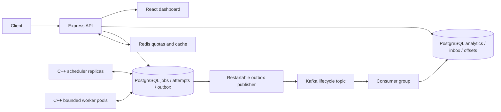

# TaskForge interview guide

## A concise explanation

TaskForge accepts work over an authenticated API, stores it durably, schedules it across C++ workers, and coordinates dependent jobs as a directed acyclic graph. PostgreSQL is the source of truth. Redis shares API quotas and caches version-checked job snapshots. Kafka distributes lifecycle facts to rebuildable analytics. The React dashboard displays these actual records and health measurements.



## Explain the implementation

1. **What does it do?** Queues predefined asynchronous handlers and tracks attempts, retries, results and workflow dependencies. The job is durable before the API acknowledges submission. Start in `apps/api/src/jobs.ts`.
2. **Why use a distributed queue?** HTTP clients need not wait for slow work, processes can fail independently, and additional workers can process independent jobs. Queue limits provide backpressure. It does not make a single indivisible handler execute in parallel.
3. **Why C++?** C++20 jthreads, stop tokens, RAII and a bounded pool make ownership and cooperative shutdown explicit. The project demonstrates systems concurrency; its benchmarks do not prove C++ is faster than every alternative. Read `services/core/include/taskforge/thread_pool.hpp` and `services/worker/main.cpp`.
4. **Why Express/TypeScript?** HTTP auth, validation and dashboard integration remain straightforward. Zod validates contracts and PostgreSQL parameters bind values. The API does not schedule jobs in memory.
5. **How do workers run concurrently?** Each lane owns a libpq connection and accepts one assignment at a time. Worker and queue row locks serialize capacity decisions. Four lanes per worker are the default; queue limits may be smaller than combined worker capacity.
6. **How are conflicting claims prevented?** The scheduler invokes transactional PostgreSQL procedures. Worker/queue/job locks and conditional state updates grant one current attempt; SKIP LOCKED avoids waiting on already selected rows. `next_assignment` conditionally changes ASSIGNED to RUNNING and checks the actual update, preventing a stale READ COMMITTED join from handing the same attempt to another lane. See migrations 001 and 003 and `tests/cases/acceptance-gate.mjs`.
7. **What are leases and heartbeats?** Workers heartbeat every second and are eligible while recently seen. A job lease expires after six seconds unless renewed; each attempt also has a fixed deadline. An attempt number fences later writes. A heartbeat is evidence of recent process contact, not proof it will execute the next assignment.
8. **How does crash recovery work?** A scheduler reconciles expired assignments, records failure/timeout, and schedules a retry after backoff or sends exhausted work to dead letter. A recently dead worker can remain eligible briefly and waste another assignment. The measured recovery sample took 15.66 seconds and three attempts; do not promise recovery within one six-second lease.
9. **Why at least once?** A handler may perform an external effect and crash before PostgreSQL confirms completion. A retry can repeat that effect. Fencing prevents an old attempt from overwriting current durable state; it cannot undo a remote HTTP request. External handlers must use stable job IDs as idempotency keys, remote unique constraints or transactional business ledgers.
10. **How do DAGs run?** Kahn validation rejects cycles in O(V+E). Root jobs become eligible at workflow start; a child waits for every predecessor to complete. Failure/cancellation propagates through descendants. Retrying a workflow clones a new execution with root lineage, preserving history. Read `workflows.ts` and `tests/cases/workflows.ts`.
11. **Why Redis?** Replica-local counters cannot enforce one shared API quota. Lua atomically increments/sets expiry. Cache keys contain project/job/state version; a PostgreSQL version lookup prevents stale writes or missing invalidation from making old state current. Cache hits still depend on PostgreSQL. Outage/OOM rejects admission with 503 and cache operations bypass failure. Existing C++ execution continues. See REDIS.md.
12. **Why Kafka?** It decouples durable lifecycle delivery and replayable analytics from job execution. Consumers never compete with the custom scheduler. One consumer group maintains an idempotent SQL projection; adding a new namespace/group can rebuild it. Kafka is not a second job-state authority.
13. **How does the outbox work?** A lifecycle trigger inserts an event within the job transaction. A publisher claims a batch, waits for Kafka acknowledgement, then conditionally records delivery. A crash after the Kafka ack but before the SQL update causes duplicate publication. Consumer inbox/projection/offset commit atomically, so duplicate processing does not increment analytics twice. Versions prevent out-of-order regression. See KAFKA.md and `apps/events/src/pipeline.ts`.
14. **How does it scale?** Add workers for available queue concurrency, add schedulers for failover/coordination throughput, and API replicas behind a configured trusted proxy with shared Redis admission. One PostgreSQL writer still coordinates assignments. Kafka partitions bound consumer group parallelism. More schedulers do not guarantee faster execution: the measured one-worker/two-scheduler sample was slower than one/one.
15. **What are the limits?** Single-node PostgreSQL and Kafka, trusted internal Kafka networking without TLS/SASL/ACLs, no per-user RBAC, cooperative handlers, no resource sandbox per job, manual history retention, and no automatic outbox/inbox retention. Benchmarks are short laptop samples. This is a tested portfolio platform, not a production certification.

## Common follow-up questions

**Does Kafka producer idempotence make the outbox exactly once?** No. PostgreSQL and Kafka commit independently. The claim-token update fences stale publishers, while the inbox deduplicates consumer effects.

**Are events strictly ordered per job?** A key chooses one partition, but multiple publisher batches and retries may arrive out of lifecycle order. Projection state_version handles that. Event counts count unique facts, not arrival order.

**What if a malformed event appears?** Invalid schemas and out-of-range versions get a durable failure marker and advance the consumed position. The original record remains in Kafka during retention. Repair the schema and replay into a fresh namespace. Database transaction failures throw instead of acknowledging unapplied work.

**What happens at Redis memory capacity?** noeviction preserves existing counters; new Redis writes can fail. Admission returns 503, cache writes are best effort, and TTL expiration releases memory. A Redis restart resets ephemeral quota windows, not durable jobs.

**What did you measure?** Four 80-job sleep10ms configurations; 20.15, 27.77, 18.70 and 34.82 observed completions/s for worker/scheduler counts 1/1, 2/1, 1/2 and 2/2. Cache means 12.21 ms hit versus 19.07 ms forced miss for ~50KB detail. 1,619 events published in 0.784 seconds including outbox claim/ack writes. Read the raw artifact and caveats before citing any number.

## Demonstrate and defend it

```sh
node scripts/setup-env.mjs
docker compose up -d --build --scale worker=2 --scale scheduler=2
docker compose run --rm admin "Interview demo"
docker compose -f compose.test.yml up --build --abort-on-container-exit --exit-code-from tests
```

Keep the newly printed project token private. Connect the browser dashboard, submit a sum, run a diamond workflow and open Metrics. For explicit outage demos, set TASKFORGE_TOKEN/TASKFORGE_QUEUE for a disposable local demo project and run `node benchmarks/stack-faults.mjs`. It stops/restarts publisher, Kafka and Redis, so use the local demo stack only. Replay commands are in KAFKA.md. Explain one observed failure window before discussing performance. Use RESUME_GUIDE.md for defensible resume bullets.
